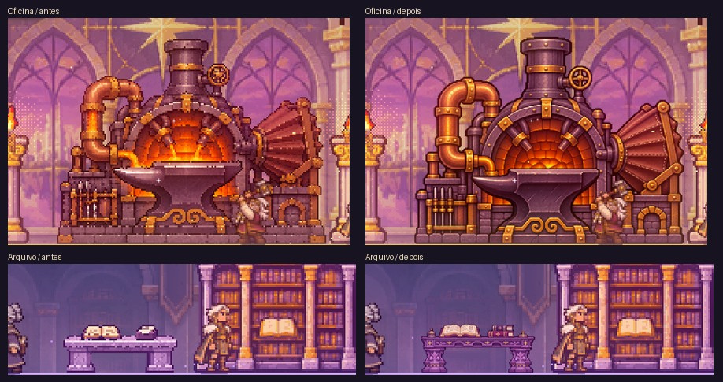
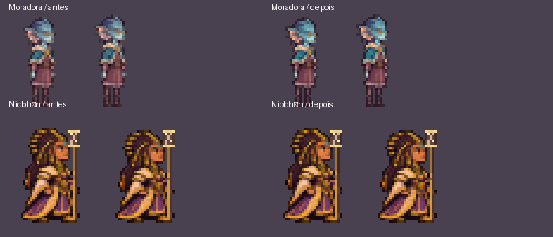

# Revisão de arte da demo Arcana

A build publicada em `c0fb19a` serviu de base para a revisão.

| Arte | Intervenção | Conferência no jogo |
| --- | --- | --- |
| Forja e bigorna de Halberd | Nova arte a partir da referência existente. Aros do forno, cobre, fole e perfil da bigorna ganham definição. | PNG de 352×288 px. A projeção continua em 176×144 px sobre o piso da oficina. |
| Mesa da arquivista de Gileád | Nova arte a partir da referência existente. Livro aberto, códices, entalhes e o vão da mesa ficam legíveis. | PNG de 128×64 px. A projeção continua em 64×32 px sobre o piso do Arquivo. |
| Moradora Morghara de Iomadh | Retoque de contraste na crista, nas barbatanas e no contorno do sprite escolhido. | As duas células de 30×40 px do idle mantêm a silhueta e a âncora ao pé. |
| Niobhán | Retoque local na borda e nas tranças durante o repouso. | As quatro células de 40×48 px mantêm a silhueta e a paleta do vestido. |

## Retratos

A auditoria independente inspecionou 70 pares de sprite e retrato no Chromium, com os assets escolhidos pelo jogo depois do carregamento. A busca por retratos genéricos de substituição voltou com zero ocorrências. O teste da build final conferiu as cartas da moradora, da conselheira, de Niobhán, Seyrín, A’Maídhe, Llewlás, Pódhraic e do Sacerdote. O retrato de base reta da moradora continua sendo o mesmo nas duas expressões. A conselheira continua com o retrato próprio. A revisão visual preservou os retratos aprovados.
