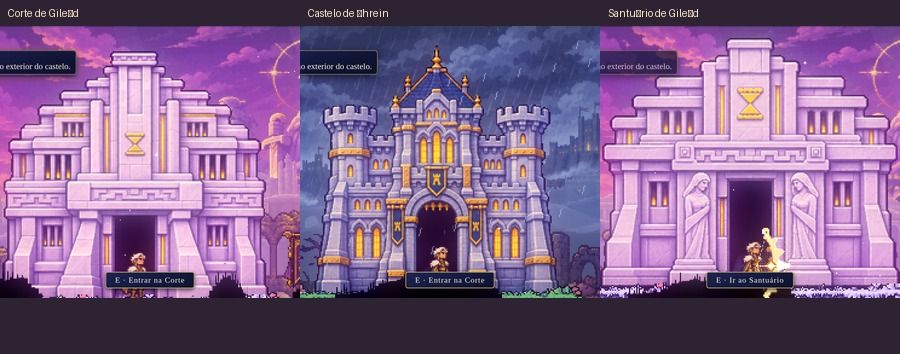
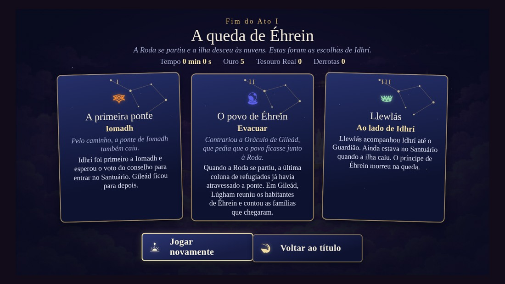
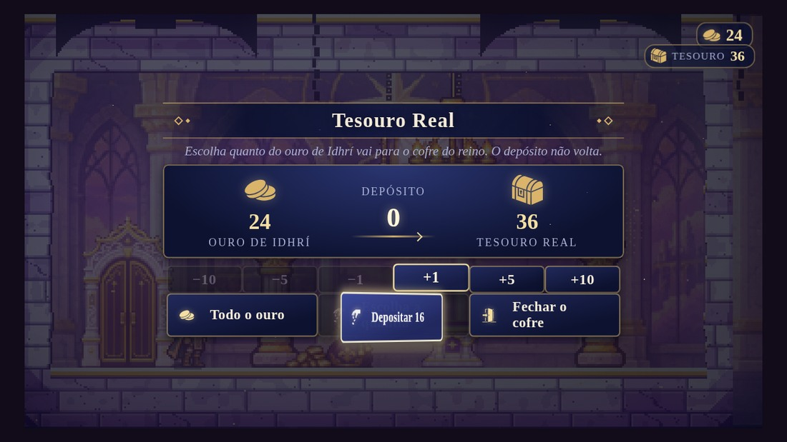

# Revisão do Jogo 21

[Baixar a demo revisada](../demo-pixel-art.zip) · [Versão original do Jogo 21](https://github.com/rf-bcllr/fortunefell/tree/1270d794fa5ffb16d96f95c1eb7354201e2a1ff5/entregas/revisao-moinho-rei-oco)

| Item | Encontrado no Jogo 21 | Ajuste nesta revisão |
| --- | --- | --- |
| 1. Epílogo | Três cartas com a primeira ponte, o conselho e a evacuação, e o destino de Llewlás. | Conferidas 16 combinações em português e inglês. O rodapé ganhou espaço próprio para os botões. Testado em três tamanhos de janela nos dois idiomas. |
| 2. Tesouro | Depósito direto com fichas e saldos atualizados durante menus. | Conferido depósito de 16 moedas pelos botões +1, +5 e +10. Os saldos do cofre e da oficina se atualizam com o menu aberto e o saldo do Tesouro aparece na chancelaria. |
| 3. Atalho de Gileád | Trinco revelado por Percepção abre a porta de contrapeso que ocupa o corredor. | O trinco libera a colisão da porta. Após descobrir a passagem pelos Arquivos, o retorno pela estante carrega a porta aberta. O percurso foi feito a pé pelos controles do jogo. |
| 4. Objetivos | Objetivos de Pódhraic e de consulta no HUD. A fala e o bloqueio tinham variantes por entrada. | A primeira entrada e a tentativa de entrar no Santuário usam a mesma fala. O bloqueio cobre as entradas do Santuário antes do encontro. |
| 5. Rumores de Pódhraic | Falas novas e ciclo do Sacerdote. A fala da moradora estava associada à figura do conselho. | O rumor do balde pertence à moradora junto ao poço. Os cinco rumores e a dica do Sacerdote são gravados ao terminar cada fala. |
| 6. Mercadora Aelvara | Comenta o cabelo de Idhrí depois do segundo anel. | O save registra a fala assim que termina. |
| 7. Besouro | A patrulha reconhece galhos de mão única. | A patrulha percorreu 346,5 px de galho, fez duas voltas nas bordas e manteve a altura durante 1.600 quadros testados. |
| 8. Posições | Niobhán à frente do trono, Seyrín atrás e Sacerdote no centro do trecho em Iomadh. | Niobhán e Seyrín foram conferidas no mapa, apoiadas na plataforma e voltadas para o salão. |
| 9. Topos | As fachadas batiam no enquadramento. O terreno pré-renderizado também cortava pixels acima da origem do mapa. | Remates completos e enquadramento pela câmera local. As fachadas são desenhadas diretamente em cena. |
| 10. Santuário | A arte tinha a resolução nativa e detalhes limitados. | Novo master baseado na fachada anterior, reduzido para a célula de 260 × 220 px. |
| 11. Halberd | O pedido concede aprovação a Myriadd. | Conferido o reino no sistema de aprovação. |
| 12. Balança | O aviso aguardava a fala, mas a marca de decisão podia parar a balança imediatamente. | A marca e o repouso começam 18 quadros após o fechamento da fala. |
| 13. Saída de Éhrein | O lembrete exigia que a chave já tivesse sido entregue. | Aparece depois da consulta, inclusive antes de Idhrí receber a chave. |
| 14. Bruxa | A fala usa Oráculo de Gileád. | Mantida a fala do Jogo 21. |
| 15. Rumores de Éhrein | O mensageiro fala da mulher na clareira e a curandeira fala do Rei Oco. | Mantidas as falas do Jogo 21. |

As três fachadas foram editadas a partir das referências do jogo e reduzidas sem deformação, mantendo os emblemas e o centro das portas. A imagem da fachada ficou um pouco menor para caber no campo visível perto da entrada.

## Cofre e epílogo na build revisada

As falas de Iomadh, o ciclo do Sacerdote e os dois rumores de Éhrein foram conferidos pela interação dos NPCs em português e inglês.
