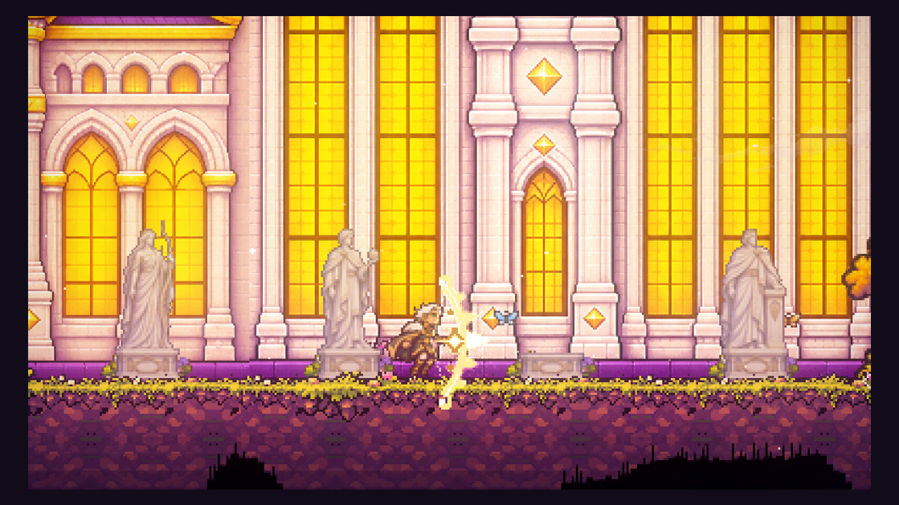
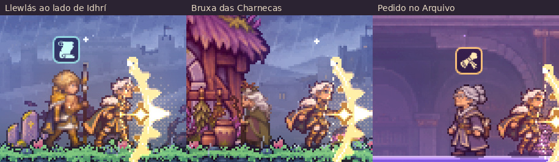
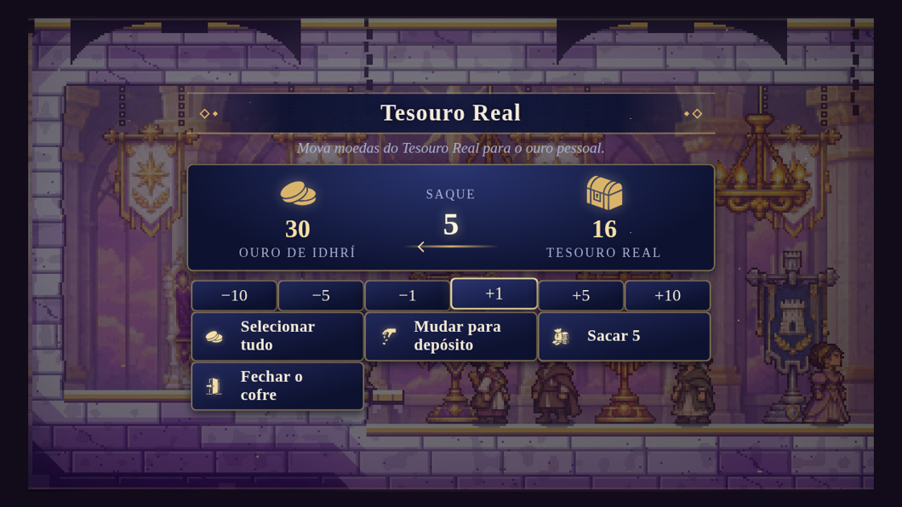

# Jardim, pedidos e conversas de Arcana

| Mudança | Conferência |
| --- | --- |
| Jardim de Myriadd | Mhóira, Mhoirín, o pedestal vazio e Midhra ficam na mesma alameda a leste do palácio. As quatro peças compartilham a escala do pedestal e o apoio no piso. Ao examinar o pedestal vazio, Idhrí diz apenas que o avô abdicou e se tornou eremita. |
| Llewlás | As oito células de caminhada e corrida foram redesenhadas sobre a referência anterior. O contorno das nove ações foi revisto preservando sua silhueta. A locomoção avança por distância percorrida e mantém os passos em baixa velocidade quando ele acompanha Idhrí. |
| Bruxa das Charnecas | A pose curvada, a cabeleira branca, o manto e o cajado foram conferidos ao lado de Idhrí no mapa. A silhueta mede 37 px de altura no quadro capturado, em célula de 40 × 48 px. A arte atual foi preservada. |
| Oxigênio | A barra começa quando o quadro desenhado de Idhrí entra inteiro na água. Foram testados o quadro um pixel acima da linha, o primeiro ponto totalmente imerso, a margem e o dano quando o fôlego acaba. |
| Pedidos | Pergaminho enrolado para uma oferta, aberto para um pedido aceito, e exclamação para falas novas após o contato anterior. Entregar o pedido remove o pergaminho. |
| Reações e lore | Seyrín, Ínys, A’Maídhe e Llúpin reagem à conclusão de pedidos relevantes de moradores e da Chancelaria. As reações são registradas no save ao serem lidas. Nióbhan, A’Maídhe e Llúpin têm dois tópicos opcionais de lore cada. |
| Tesouro Real e Chancelaria | A guardiã e Pódhraic abrem a conversa antes do painel. A guardiã fala sobre Myrdhórin e o livro do cofre. Pódhraic, depois de retornar ao castelo, responde sobre os sete demais reinos e sobre o palácio. |
| Transferências | O mesmo painel aceita depósito e saque, com fichas de 1, 5 e 10, limites pelo saldo de origem e prévia dos dois saldos. O teste depositou 16, sacou 15 e esvaziou o Tesouro sem saldo negativo. Os valores persistem no save. |

[Comparação da folha de Llewlás](llew-comparacao.png) · [Cobertura do pacote de ícones anexado](auditoria-icones.md)

Os diálogos, escolhas, reações, pedidos e serviços foram testados no Chromium em português e inglês. A comparação de Llewlás usa a célula de 68 × 52 px, a mesma do sprite anterior, com o apoio dos pés preservado. No percurso instrumentado, o companheiro ficou a cerca de 23–25 px de Idhrí em movimento e na parada.
