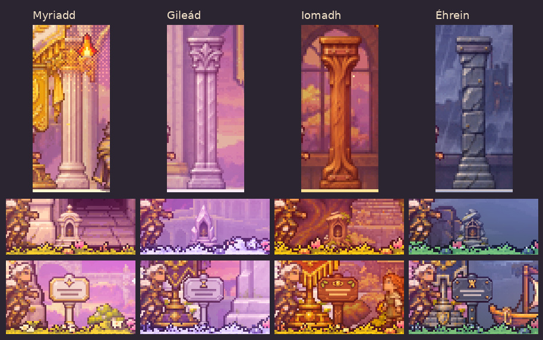
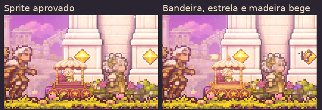

# Revisão da carruagem e da sinalização

As artes de carruagem, pilastras e checkpoints publicadas em `39433a5` foram rejeitadas pelo autor. Os testes daquela publicação verificaram o funcionamento, e não houve aprovação artística independente.

| Elemento | Fonte desta revisão | Tamanho no mapa |
| --- | --- | --- |
| Carruagem de Ínys | Redesenho gerado e revisto a partir da cena de inspeção. A capota marfim, o assento ameixa e as quatro rodas visíveis com estrelas douradas fazem a ligação com a cena. O boneco continua legível sob a capota. A versão final tem bandeira vazia, estrela no topo e carroceria de madeira bege. | 34 × 33 px com PNG de 68 × 66 px |
| Pilastras | Quatro sprites novos. Calcário trabalhado em Myriadd, pedra lilás entalhada em Gileád, madeira com cobre em Iomadh e lajes de ardósia em Éhrein. | Células de 28 × 86 px |
| Checkpoints | Quatro sprites novos com base de pedra ou madeira, nicho e cristal. O cristal muda de luminosidade na ativação. | 20 × 25 px com células de 40 × 50 px |
| Placas | Duas folhas reexportadas diretamente dos masters fornecidos, com os quatro originais de cada tamanho. Cada folha tem quatro células de 80 × 80 px. | Modelos pequeno e grande em células lógicas de 32 × 32 e 40 × 40 px |

Os testes em Chromium verificaram os PNGs carregados em cena, os dois modelos de placa no mesmo patamar, textos em português e inglês e os quatro checkpoints antes e após a ativação. O checkpoint preserva a restauração de vida e a gravação da posição. As capturas foram conferidas no tamanho do jogo.

[Baixar as exportações PNG e as células individuais](exportacoes-arte.zip)
