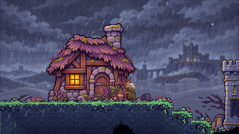
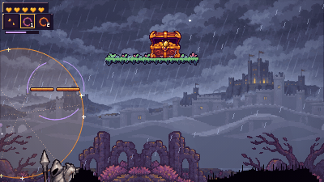
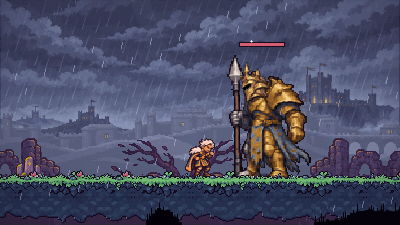
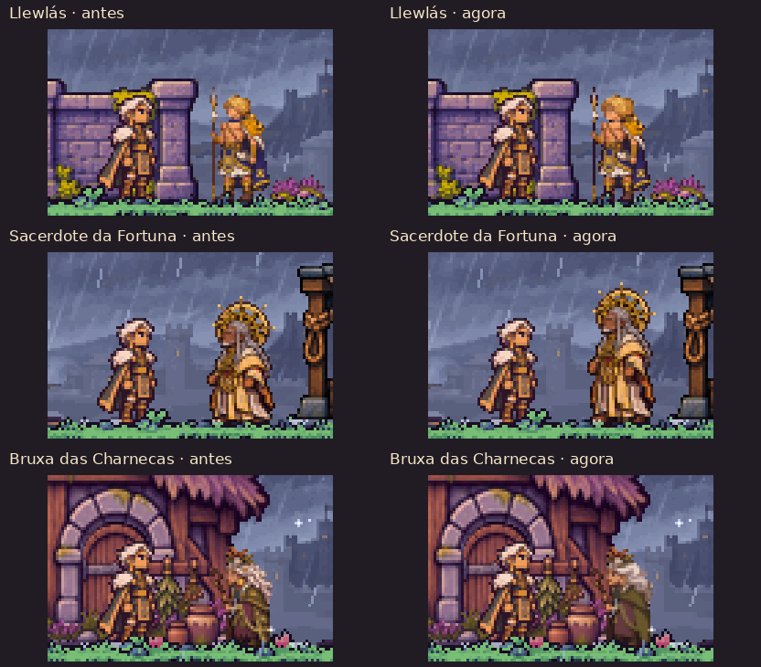
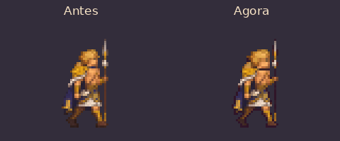

# A Clareira da Bruxa

[Baixar a demo desta revisão](../demo-pixel-art.zip)

A gatehouse das Charnecas desemboca numa bifurcação. Subindo a oeste, Idhrí chega à cabana. A trilha leste atravessa dois baixios e termina no campo do Rei Oco. É possível voltar pelo mesmo caminho a qualquer momento.

Acima do segundo baixio, uma flecha de Percepção revela o primeiro apoio. A plataforma seguinte sobe e desce. Uma flecha de Tempo mantém a plataforma na altura do salto para o tesouro. A caçada continua pelo chão.

## Personagens em jogo

Cada par mostra a build anterior à esquerda e a revisão à direita. Idhrí serve de referência na mesma cena. As capturas foram ampliadas para facilitar a inspeção.

