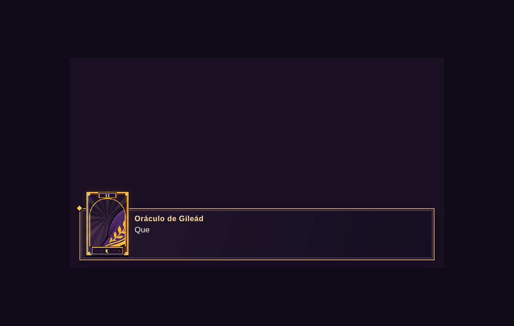
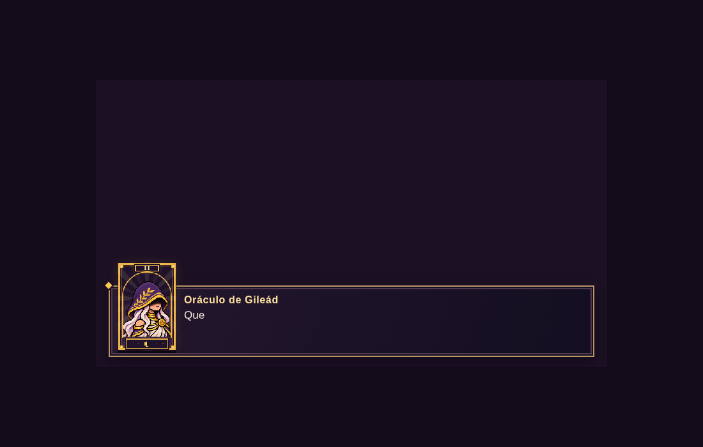

# Morghara de Iomadh

A candidata com crista foi reprovada. Na célula de 30 × 40 px, tem 38 px de altura visível, como o morador do rio, mas o rosto se mistura à nadadeira e os braços desaparecem contra a roupa. A capa azul-petróleo do retrato também perde espaço para o rosa da túnica. A comparação usa um quadro por personagem, com a mesma ampliação e os pés alinhados.

Na demo, a figura da vila de Iomadh (69, 13) e a figura no conselho (36, 12) compartilham o sprite `dwellerB`. O redesenho da moradora precisa de uma entrada própria. A identificação do retrato destinado a ela aguarda os arquivos nomeados.

## Sprites e retratos da versão atual

A prancha acima registra a versão do jogo usada na auditoria. Nos quatro militares, a avaliação preliminar favorece preservar as silhuetas e comparar cada cabeça com o novo retrato correspondente, especialmente a projeção das nadadeiras, o elmo ou diadema e a massa de cabelo.

## Auditoria do diálogo

Foram testados 57 falantes em 217 situações. Os 169 retratos carregaram e passaram pela moldura de diálogo. Três falantes recorriam ao busto genérico. Na cópia de teste, ligar os dois falantes do rio aos retratos do morador e do guarda corrigiu esses dois casos. O cortesão do jardim (`courtierP`) ainda precisa de um retrato próprio.

Seyrín tinha um retrato de 256 × 256 px desenhado pelo tamanho da fonte no espaço de 128 × 128 px. Dar à imagem o tamanho do quadro recuperou o rosto e o busto.

| Na demo | Na cópia de teste |
| --- | --- |
|  |  |

## Divergência visual em relação a Idhrí

Notas editoriais dos retratos anteriores ao envio das novas artes. A ordem usa a média ponderada de enquadramento (30%), traço (40%) e detalhe (30%). Problemas de carregamento ou corte precisam de correção mesmo quando a arte tem nota baixa.

| Família | Enquadramento | Traço | Detalhe | Divergência |
| --- | ---: | ---: | ---: | ---: |
| oracle (exp) | 100% | 15% | 20% | 42% |
| llewlas | 65% | 20% | 25% | 35% |
| podhraic | 20% | 35% | 35% | 30.5% |
| governor (exp) | 45% | 20% | 20% | 27.5% |
| Llúpin | 25% | 30% | 25% | 27% |
| king (exp) | 35% | 15% | 20% | 22.5% |
| hag (exp) | 20% | 20% | 25% | 21.5% |
| vaultkeeper_new | 25% | 15% | 20% | 19.5% |
| artificer (exp) | 15% | 20% | 20% | 18.5% |
| queen (exp) | 15% | 20% | 20% | 18.5% |
| inys (exp) | 10% | 20% | 20% | 17% |
| Sacerdote Fortuna | 15% | 15% | 20% | 16.5% |
| gilead_apprentice | 10% | 15% | 15% | 13.5% |
| gilead_citizenG2 | 10% | 15% | 15% | 13.5% |
| gilead_officer_veteran | 10% | 15% | 15% | 13.5% |
| Exército airgead | 10% | 10% | 15% | 11.5% |
| Exército ehrein | 10% | 10% | 15% | 11.5% |
| Exército fiodhor | 10% | 10% | 15% | 11.5% |
| Exército gilead | 10% | 10% | 15% | 11.5% |
| Exército iomadh | 10% | 10% | 15% | 11.5% |
| Exército morgwang | 10% | 10% | 15% | 11.5% |
| Exército myriadd | 10% | 10% | 15% | 11.5% |
| Exército nemet | 10% | 10% | 15% | 11.5% |
| artificer | 10% | 10% | 15% | 11.5% |
| child_terrace | 10% | 10% | 15% | 11.5% |
| dwellerB | 10% | 10% | 15% | 11.5% |
| governor | 10% | 10% | 15% | 11.5% |
| heir | 10% | 10% | 15% | 11.5% |
| king | 10% | 10% | 15% | 11.5% |
| priest_iomadh | 10% | 10% | 15% | 11.5% |
| queen | 10% | 10% | 15% | 11.5% |
| apprentice | 10% | 10% | 10% | 10% |
| archivist | 10% | 10% | 10% | 10% |
| bridgeKeeper | 10% | 10% | 10% | 10% |
| child | 10% | 10% | 10% | 10% |
| childI | 10% | 10% | 10% | 10% |
| chronicler | 10% | 10% | 10% | 10% |
| citizenG1 | 10% | 10% | 10% | 10% |
| citizenG2 | 10% | 10% | 10% | 10% |
| commander | 10% | 10% | 10% | 10% |
| cook | 10% | 10% | 10% | 10% |
| councilA | 10% | 10% | 10% | 10% |
| councilB | 10% | 10% | 10% | 10% |
| councilC | 10% | 10% | 10% | 10% |
| counselor | 10% | 10% | 10% | 10% |
| courtierA | 10% | 10% | 10% | 10% |
| courtierB | 10% | 10% | 10% | 10% |
| dwellerA | 10% | 10% | 10% | 10% |
| explorer | 10% | 10% | 10% | 10% |
| farmer | 10% | 10% | 10% | 10% |
| fisher | 10% | 10% | 10% | 10% |
| gardener_myriadd | 10% | 10% | 10% | 10% |
| gateGuardE | 10% | 10% | 10% | 10% |
| gateGuardG | 10% | 10% | 10% | 10% |
| gateGuardI | 10% | 10% | 10% | 10% |
| healer | 10% | 10% | 10% | 10% |
| keeper | 10% | 10% | 10% | 10% |
| marshal | 10% | 10% | 10% | 10% |
| merchA | 10% | 10% | 10% | 10% |
| merchB | 10% | 10% | 10% | 10% |
| messenger | 10% | 10% | 10% | 10% |
| officer | 10% | 10% | 10% | 10% |
| petitioner | 10% | 10% | 10% | 10% |
| petitioner2 | 10% | 10% | 10% | 10% |
| sailor | 10% | 10% | 10% | 10% |
| smith | 10% | 10% | 10% | 10% |
| soldier | 10% | 10% | 10% | 10% |
| vaultkeeper | 10% | 10% | 10% | 10% |
| Idhrí | 0% | 0% | 0% | 0% |
