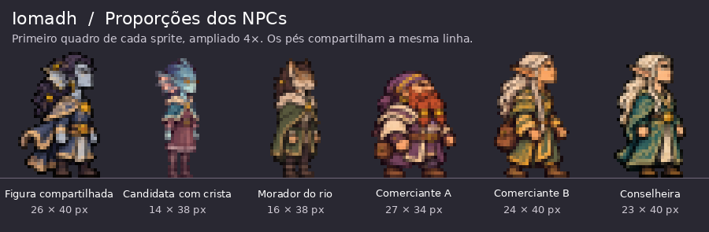
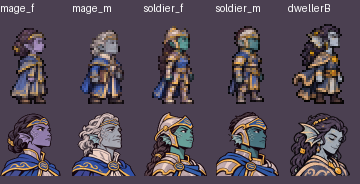

# Morghara de Iomadh

A candidata com crista foi reprovada. Na célula de 30 × 40 px, tem 38 px de altura visível, como o morador do rio, mas o rosto se mistura à nadadeira e os braços desaparecem contra a roupa. A capa azul-petróleo do retrato também perde espaço para o rosa da túnica. A comparação usa um quadro por personagem, com a mesma ampliação e os pés alinhados.

Na demo, a figura da vila de Iomadh (69, 13) e a figura no conselho (36, 12) compartilham o sprite `dwellerB`. O redesenho da moradora precisa de uma entrada própria. A identificação do retrato destinado a ela aguarda os arquivos nomeados.

## Sprites e retratos da versão atual

A prancha acima registra a versão do jogo usada na auditoria. Nos quatro militares, a avaliação preliminar favorece preservar as silhuetas e comparar cada cabeça com o novo retrato correspondente, especialmente a projeção das nadadeiras, o elmo ou diadema e a massa de cabelo.
