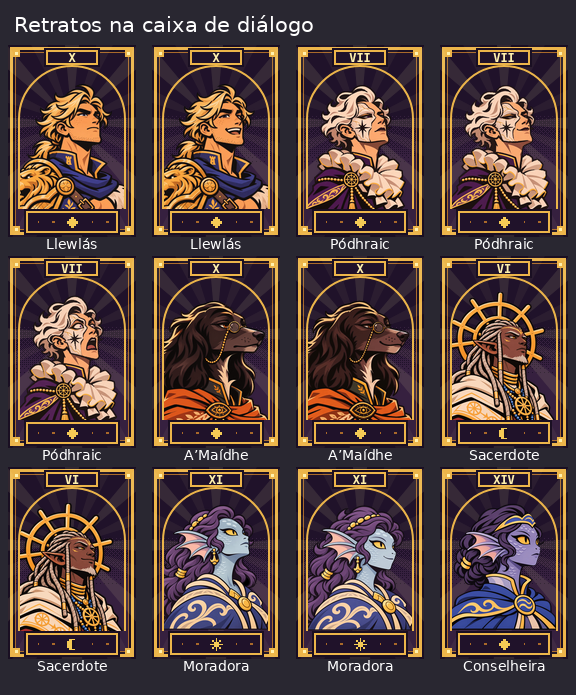
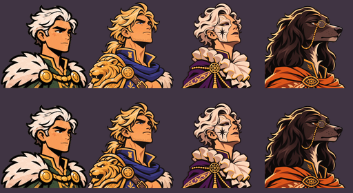
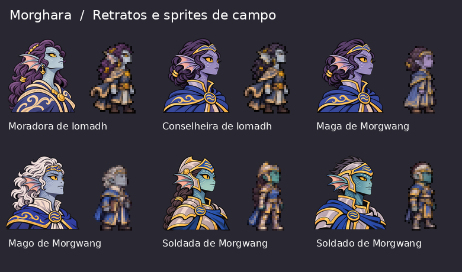

# Retratos e moradora de Iomadh

[Baixar a demo](../../demo-pixel-art.zip) · [Baixar os retratos](../../retratos.zip)

Foram integradas 15 ilustrações do arquivo do autor. Consultei os nomes dos PNGs para identificar a moradora de cabelo roxo longo e a conselheira de diadema. As duas imagens com prefixo REF e crista azul serviram como referências. A folha própria da moradora tem dois quadros de 30 × 40 px, com o contorno e os pés alinhados ao sprite anterior.

O recorte de cada rosto mantém a proporção original. O desenho ocupa um quadrado de 128 × 128 px dentro da carta de 128 × 192 px. Os vãos da roda do Sacerdote são transparentes. No teste em Chromium, os 16 casos de falante e expressão desenharam os retratos esperados. O carregamento terminou sem falhas de arte ou erros JavaScript. Os testes cobriram a caixa de diálogo e as identidades da vila e do conselho.

## Espessura do traço

Idhrí aparece na primeira coluna como referência. A linha superior mostra a redução inicial. Na inferior, o contorno de Llewlás, Pódhraic e A’Maídhe recebeu um reforço discreto para manter a leitura em tamanho de jogo.

## Retrato e sprite de cada Morghara

Nos quatro militares, o uniforme e a silhueta sustentam a identificação de cada função. O sprite da representante do conselho ainda usa o traje e a silhueta antigos. A diferença mais visível em relação ao retrato novo é o cabelo, que no retrato está preso sob o diadema. A alteração de sprite desta entrega foi aplicada à moradora da vila.
